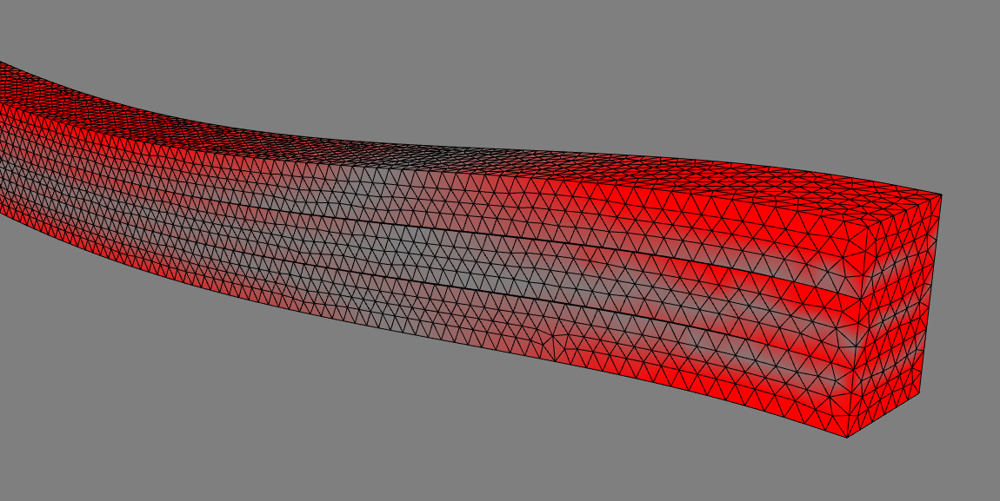

# FrdReader
A library for reading both binary and ASCII `.frd` results files from CalculiX.
Includes .NET/CLI and Python wrappers.



## Installation

- Clone the repository.

For `libfrd`, in the repository directory:
```
mkdir build
cd build
cmake ..
cmake --build . --config Release
```

For the `FrdReader` .NET assembly:
- Build the project in the `FrdReader` subdirectory.

For `pyfrd`:
- In the `pyfrd` subdirectory, run `pip install .`

This will build and install `pyfrd` and its dependencies using the `scikit-build-core` build system.

## Dependencies
- CMake v3.15 or higher

Additionally, for `pyfrd`:
- Python
- sci-kit-build (`pip install scikit-build`)

## Dynamic results

`FrdReader` reads the extra `1P` parameter records preceding modal result blocks
in both ASCII and binary CalculiX FRD files. Results remain indexed by result
step, field, component, and node, so successive eigenmodes do not overwrite each
other:

```python
from pyfrd import FrdReader

reader = FrdReader()
reader.read("results.frd")
for step, fields in reader.values.items():
    header = reader.metadata[step]["DISP"]
    if header.mode > 0:
        print(header.mode, header.value)  # Mode number and frequency in Hz
        displacement_x = fields["DISP"]["D1"]
```

`metadata[step][field]` exposes `mode`, `analysis`, and `value` in addition to
the existing header properties. For static results, `mode` is zero and `value`
is the result time. Mode numbers and result step numbers can differ. Frequencies
are stored as written by CalculiX, without application-specific corrections.
Rebuild the Python extension to use this API; a previously installed binary
will not include it.

After building/installing `pyfrd`, run the standalone regression tests:

```bash
python -m unittest discover -s tests -v
```

These tests cover static and multiple modal datasets, ASCII and binary input,
mode frequencies, displacement-only results, sparse node IDs, and reader reuse.
